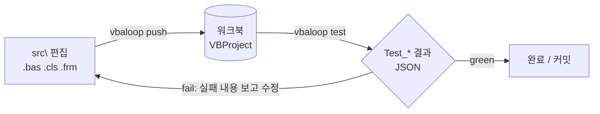

<h1 align="center">vbaloop</h1>

<p align="center">
  <b>코드 에이전트가 Excel VBA를 직접 고치고 테스트하게 해 주는 Windows CLI</b><br>
  Claude Code·Codex가 편집 → push → test → 수정을 사람 손 없이 반복한다
</p>

<p align="center">
  <a href="https://github.com/rfastball/vbaloop/releases/latest"></a>
  <a href="https://github.com/rfastball/vbaloop/actions/workflows/ci.yml"></a>
  
  <a href="LICENSE"></a>
</p>

<p align="center">
  <a href="#시작하기">시작하기</a> ·
  <a href="#작동-방식">작동 방식</a> ·
  <a href="#명령">명령</a> ·
  <a href="AGENT_SETUP.md">에이전트 설치 절차</a> ·
  <a href="DESIGN.md">설계</a>
</p>

> [!NOTE]
> **코드 에이전트에게 (For coding agents):** 사용자가 이 레포 주소와 함께 VBA·Excel 프로젝트의 설치나 세팅을
> 요청했다면 [AGENT_SETUP.md](AGENT_SETUP.md) 절차를 그대로 따른다. If a user gave you this repository to set up a
> VBA/Excel project, follow [AGENT_SETUP.md](AGENT_SETUP.md).

## 시작하기

### 준비물

- **Windows + 데스크톱 Excel.** 웹용·모바일 Excel은 자동화할 수 없다.
- **Claude Code 또는 Codex** (권장). vbaloop는 에이전트가 쓰도록 만든 도구지만, 명령은 사람이 직접 실행해도 된다.

새 프로젝트든 기존 워크북이든 시작 방법은 같다. 아래 둘 중 하나만 하면 된다.

### 방법 1. 터미널에서 직접 설치

**기존 워크북이 있는 폴더**, 또는 **새 프로젝트로 쓸 빈 폴더**에서 PowerShell을 열고 실행한다.

```powershell
irm https://raw.githubusercontent.com/rfastball/vbaloop/master/install.ps1 | iex
```

설치가 끝나면 바로 세팅으로 넘어간다. 폴더에 무엇이 있는지 보고, 바꾸기 전에 먼저 묻는다.

| 실행한 폴더 | vbaloop가 묻는 것 | 동의하면 |
|---|---|---|
| `정산.xlsm`이 있음 | "현재 폴더의 정산.xlsm을(를) 가져올까요?" | 옆에 `정산\` 폴더를 만들고 워크북을 복사해 **사본**으로 작업한다. 원본 워크북은 수정하지 않는다 |
| `.xlsm`이 여러 개 | 가져올 워크북 번호 | 고른 워크북을 위와 같이 사본으로 가져온다 |
| 비어 있음 | "여기에 새 프로젝트를 만들까요?" | 폴더 이름으로 워크북과 샘플 테스트를 만들고, 테스트가 실제로 통과하는지 확인한다 |

Excel 보안 설정 "VBA 프로젝트 개체 모델에 대한 신뢰할 수 있는 액세스"(AccessVBOM)가 꺼져 있으면 켤지 묻는다.
vbaloop가 워크북의 VBA 코드를 읽고 쓰려면 이 설정이 필요하다. 끝으로 Claude Code가 설치돼 있으면 새 프로젝트 폴더에서
Claude Code를 새 창으로 열지 묻는다.

### 방법 2. 에이전트에게 맡기기

기존 워크북이 있는 폴더나 빈 폴더에서 Claude Code나 Codex를 열고 이렇게 말한다.

```text
https://github.com/rfastball/vbaloop 로 이 폴더에 vbaloop를 세팅해줘
```

에이전트가 [AGENT_SETUP.md](AGENT_SETUP.md)대로 진행한다.

1. vbaloop 설치
2. 현재 폴더를 보고 기존 워크북인지 새 프로젝트인지 판단
3. `setup --plan`으로 무엇이 바뀌는지 보여주고 동의를 받는다. Excel 보안 설정이나 PATH처럼 PC를 바꾸는 항목은 반드시 묻는다
4. 세팅하고 결과를 보고한다

### 세팅이 끝나면

기존 워크북 `정산.xlsm`에서 시작했다면 폴더가 이렇게 된다.

```text
정산.xlsm                  원본 워크북 (수정하지 않음)
정산\                      ← 프로젝트 폴더. 에이전트는 이 폴더에서 연다
├─ 정산.xlsm               작업용 사본. push가 코드를 넣는 워크북
├─ src\                    워크북에서 꺼낸 모듈 (.bas .cls .frm) + 테스트용 LogShim.bas
├─ vbaloop.toml            프로젝트 설정
├─ CLAUDE.md, AGENTS.md    에이전트가 따를 규칙 (vbaloop가 관리하는 블록만 갱신)
├─ .claude\skills\vbaloop\ 실패했을 때 대응 절차 (Claude Code 스킬)
└─ .gitignore              _dbg\(로그·백업), dist\(배포본) 제외
```

이제 프로젝트 폴더에서 에이전트에게 평소처럼 일을 시키면 된다.

```text
modCalc의 합계 함수에 테스트를 붙이고 돌려줘
빈 시트에서 Run_Report 매크로가 오류 나는 거 고쳐줘
배포용 xlsm 만들어줘
```

에이전트는 `src\`를 고치고, `vbaloop push`로 사본 워크북에 반영한 뒤 `vbaloop test`로 확인한다. 실패하면 결과를 보고 다시 고친다.

<details>
<summary><b>다른 시작 방법</b> (exe 드래그 앤 드롭, 더블클릭, 명령 옵션)</summary>

<br>

이미 설치돼 있으면 워크북이 있는 폴더나 빈 폴더에서 `vbaloop setup`만 실행하면 된다. 방법 1과 똑같이 현재 폴더부터 제안한다.

- **기존 워크북**: `.xlsm`을 `vbaloop.exe` 위로 끌어다 놓는다.
- **새 프로젝트**: `vbaloop.exe`를 더블클릭하고 "기존 워크북(.xlsm)을 가져올까요?"에 `n`을 입력한 뒤 프로젝트 이름을 입력한다.
  프로젝트는 `%USERPROFILE%\vbaloop-projects\<이름>\`에 만들어진다.
- exe는 [릴리스](https://github.com/rfastball/vbaloop/releases/latest)에서 받는다. 서명되지 않은 exe라 SmartScreen 경고가
  뜨면 `추가 정보` → `실행`을 누른다.

명령으로 시작점을 직접 지정할 수도 있다.

```powershell
vbaloop setup --workbook C:\work\정산.xlsm    # 기존 워크북 → C:\work\정산\ 에 사본
vbaloop setup --new MyTool                     # 새 프로젝트 → .\MyTool\
vbaloop setup --folder C:\work\MyVba           # 준비해 둔 폴더(워크북 0~1개)를 그대로 사용
vbaloop setup --plan --workbook C:\work\정산.xlsm   # 아무것도 바꾸지 않고 계획만 보기
```

- 사본 폴더 이름이 이미 쓰이고 있으면 `<이름> (2)`처럼 비어 있는 이름을 쓴다. 같은 워크북으로 다시 실행하면 이전에 만든 폴더를 재사용한다.
- 사본을 둘 폴더를 직접 정하려면 `--workbook <경로> --folder <폴더>`를 함께 쓴다.
- `--yes`는 묻지 않고 진행한다(Claude Code 실행 제안도 건너뛴다). 단 AccessVBOM은 `--yes`로 켜지지 않는다.
  꺼져 있다면 `--enable-vbom`을 따로 붙여야 한다.
- 설치 한 줄로 설치만 하고 세팅은 건너뛰려면, 실행 전에 `$env:VBALOOP_NO_SETUP=1`을 설정한다. 입력을 받을 수 없는
  셸(에이전트, CI)에서는 이 설정 없이도 세팅을 묻지 않고 에이전트용 안내만 출력한다.

</details>

## 작동 방식



에이전트는 xlsm 안의 VBA 코드를 직접 읽거나 고칠 수 없다. 그래서 vbaloop는 코드를 `src\`의 텍스트 파일로 꺼내 두고,
이 파일을 코드의 기준으로 삼는다. 에이전트가 파일을 고치면 vbaloop가 워크북의 VBA 프로젝트에 넣고 컴파일이 되는지
확인한 뒤 저장한다. 그다음 테스트 프로시저를 사람 조작 없이(헤드리스) 실행해 결과를 JSON으로 돌려준다. 에이전트는 그
결과를 보고 다음에 할 일을 정한다.

기본 설정에서는 명령마다 화면에 보이지 않는 Excel을 새로 띄우고, 명령이 끝나면 닫는다(명령당 1~2초). 테스트는 워크북을
읽기 전용으로 열어 실행하므로, 테스트가 시트를 바꿔도 워크북에는 남지 않는다. Excel을 계속 띄워 두고 빠르게 반복하고
싶으면 `vbaloop session start`로 세션을 열면 된다. 그 세션이 살아 있는 동안에는 모든 명령이 그 Excel을 쓴다.

## 특징

| | |
|---|---|
| **한글이 깨지지 않는 왕복** | src와 워크북 사이에서 코드를 파일이 아닌 메모리(`CodeModule.Lines`)로 주고받아 코드페이지 변환이 없다. 한글처럼 시스템 코드페이지(ACP)에 있는 문자는 그대로 보존된다. 없는 문자(em dash, 이모지 등)는 VBE가 `?`로 바꿔 버리므로, push가 저장 전에 거부한다 |
| **안전한 push** | 코드를 넣기 직전에 워크북을 백업한다. 넣은 코드가 컴파일되지 않거나 도중에 실패하면 저장하지 않는다. 디스크의 워크북은 push 이전 그대로다. 나중에라도 `rollback`으로 백업에서 복원할 수 있다 |
| **헤드리스 테스트** | 테스트를 별도 프로세스에서 실행하고 시간 제한을 건다. VBE 오류 대화상자는 Office 언어와 상관없이 자동으로 닫는다 |
| **일회용 Excel** | 기본은 명령마다 숨은 Excel을 띄우고 닫는다. 명령 사이에 남는 Excel이 없어 꼬일 상태가 없고, 테스트는 매번 디스크의 워크북에서 깨끗하게 시작한다 |
| **사용자 Excel 보호** | 응답하지 않는 Excel에 사용자 작업이 남아 있을 수 있으면 강제로 종료하지 않는다. 대신 격리 상태로 표시하고 확인을 요청한다(`recovery status`). 이미 열어 둔 워크북은 `session attach`로 그대로 쓴다 |
| **에이전트 연동** | `init`이 `CLAUDE.md`/`AGENTS.md`의 관리 블록과 Claude Code 스킬을 설치하고 최신으로 유지한다. 모든 명령이 `--json`을 지원한다 |
| **배포본 빌드** | `dist`가 테스트 모듈을 빼고 버전을 찍은 뒤, VBE 컴파일 검증까지 통과한 `.xlsm`/`.xlam`을 만든다. `.txt` 패키지로 만들면 업무 워크북의 코드만 바꿀 수 있다 |
| **단일 exe** | 애드인이나 런타임 설치가 필요 없다. 설치 스크립트는 SHA-256을 확인한 뒤 `%LOCALAPPDATA%\vbaloop\bin` 한 곳에만 설치한다 |

## 테스트 작성

표준 모듈에 인자 없는 `Public Sub Test_*()`를 만들면 테스트가 된다. 단언은 `LogShim.AssertEq`를 쓴다.

```vb
Public Sub Test_SumTo()
    LogShim.AssertEq "1부터 3까지 합", 6, modCalc.SumTo(3)
    LogShim.AssertEq "0이면 0", 0, modCalc.SumTo(0)
End Sub
```

- 판정: 런타임 오류 없이 끝나고 실패한 단언이 0건이면 pass.
- `src\LogShim.bas`는 `init`이 넣고 관리한다. 직접 고치지 않는다.
- `Debug.Assert`는 헤드리스에서 아무 신호도 내지 않으므로 쓰지 않는다. 테스트 안에서 `MsgBox`·`InputBox`도 쓰지 않는다.
- 기본 설정에서 테스트는 워크북을 읽기 전용으로 열어 실행한다. 테스트 안에서 워크북을 저장(`ThisWorkbook.Save`)하지 않는다.

### 긴 실행과 취소

`test`와 `run`은 시간 제한 없이 매크로가 끝날 때까지 기다리고, 30초마다 진행 상황을 stderr에 한 줄 쓴다.

- **취소**: Ctrl+C(또는 에이전트의 작업 중지)를 누르면 매크로가 다음 `LogShim` 호출에서 멈춘다. 결과는
  `cancelled`이고 그때까지의 기록은 남는다. 30초 안에 멈추지 않거나 Ctrl+C를 한 번 더 누르면 강제로 끝낸다
  (일회용 Excel은 정리하고, 사람 작업이 있을 수 있는 Excel은 격리한다).
- **LogShim을 부르지 않는 긴 루프**에는 `LogShim.Poll`을 넣는다. 확인만 하고 기록은 남기지 않는다.
- **`--timeout <초>`**는 스크립트·CI용 선택 옵션이다. 시간이 되면 위와 같이 취소한다. 아무도 취소하지 않는
  실행은 `[run] maxSeconds`(기본 3600초)에서 같은 방식으로 끝난다.
- **대화상자**: `MsgBox`·`InputBox`·파일 대화상자·모달 UserForm이 5초 넘게 남으면 그 실행은 곧바로 실패한다.
- 취소는 `End`와 같아서 매크로의 정리 코드(열었던 워크북 닫기 등)도 실행되지 않는다. 그래서 취소나 런타임 오류로
  끝난 매크로가 바꾼 `EnableEvents`·`Calculation`·`StatusBar`·`Interactive`·`Cursor`는 vbaloop가 실행 전 값으로
  되돌리고, 매크로가 연 채 남긴 통합 문서는 일회용 세션이면 저장 없이 닫는다(새 문서와 변경이 없는 문서만 — 변경이 남은
  파일과 유지 세션에서는 알리기만 한다).
  반쯤 쓴 시트 데이터는 되돌리지 않으니 테스트 셋업은 매번 처음부터 만들게 짠다.
- `test`·`run`은 취소를 받는 현재 `LogShim`이 필요하다. 오래된 프로젝트는 `vbaloop init` 후 `push`한다.
- 실행 중에는 같은 프로젝트의 다른 명령이 거부된다. vbaloop 프로세스만 강제 종료되면 실행을 맡은 자식 프로세스가
  매크로를 멈추고 정리할 때까지(최대 30초 유예) 유지된다. 프로세스 트리째 종료되면 다음 명령이 매크로에 멈춤을 요청하고,
  멈췄다는 기록이 나오거나 30초가 지날 때까지 거부한다.

## 명령

| 명령 | 설명 |
|---|---|
| `setup [--workbook <xlsm> \| --new <이름> \| --folder <경로>] [--plan] [--enable-vbom]` | 프로젝트 세팅 마법사. 질문을 하는 유일한 명령이다. `--plan`은 바꾸지 않고 계획만 보여준다 |
| `init [--check] [--all]` | 관리 파일(규칙 블록, 스킬, `LogShim.bas`) 설치·갱신. `--check`는 검사만 하고, `--all`은 이 PC에서 쓴 프로젝트 전부를 갱신한다 |
| `doctor [--fix] [--kill-orphans]` | 환경 점검. `--fix`는 AccessVBOM을 켜고, `--kill-orphans`는 창 없이 남은 자동화 Excel을 정리한다(먼저 `doctor`로 대상 확인) |
| `status` | 세션 상태, src가 워크북에 반영됐는지 |
| `session start\|attach\|stop` | 계속 띄워 두는 Excel 세션 시작, 이미 열린 워크북 채택, 종료(`--no-save`, `--discard`) |
| `push [--force] [--prune] [--skip-compile]` | src를 워크북에 반영. 컴파일이 통과해야 저장한다 |
| `push --package <txt> --workbook <파일> [--plan] [--adopt] [--allow-downgrade]` | 텍스트 패키지로 업무 워크북의 코드만 교체(프로젝트 불필요) |
| `form build --spec <json> --code <vba> [--force]` | JSON 디자인과 VBA 코드로 src에 frm/frx 생성. 이후 `push`로 적용 |
| `pull [--force]` | 워크북 코드를 src로 가져오기 |
| `diff [--module <이름>]` | 워크북과 src 비교(아무것도 바꾸지 않음) |
| `test [--timeout <초>]` | `Test_*` 테스트 실행. 끝날 때까지 기다린다(아래 "긴 실행과 취소") |
| `run <Module.Proc> [--timeout <초>]` | 매크로 1개 실행. 끝날 때까지 기다린다 |
| `rollback --list\|--latest\|--backup <id>` | push 직전 백업으로 워크북 복원 |
| `recovery status\|clear [--force]` | 격리 상태 확인·해제 |
| `lint` | 인코딩·규약 검사(Excel 불필요) |
| `dist [--out <경로>]` | 배포본 빌드. 확장자로 형식을 고른다(`.xlsm`/`.xlam`/`.txt` 패키지) |
| `lease acquire\|release\|status\|break` | 여러 에이전트가 한 프로젝트를 동시에 쓰지 않게 하는 잠금(보통 자동) |
| `bugreport "<제목>"` | vbaloop 결함 리포트 작성 |
| `version` | 버전과 빌드 정보 |
| `update [--check] [--yes]` | 최신 릴리스로 vbaloop 갱신(SHA-256 확인). 끝나면 `init --all` 실행 여부를 묻는다 |

- 모든 명령은 `--json`을 지원한다: `{command, ok, exitCode, hint, session, errors[], payload}`.
  새 버전 알림이 있으면 `update: {current, latest, command}`가 덧붙는다
- 실패하면 한 줄 에러와 다음에 할 일(`hint`)을 알려 준다.
- 종료 코드: 성공 0 / 환경 오류 3(세션·Excel 문제, 사용 중, 격리) / 그 외 2

### 업무 워크북에 코드만 배포하기

현장에서 데이터를 쌓아 온 업무 워크북은 배포본으로 덮어쓸 수 없다. 이때는 코드만 담은 텍스트 패키지를 만들어
반입하고, 대상 PC에서 그 워크북에 적용한다. 시트·데이터·이름 정의·서식은 그대로 남는다.

```powershell
vbaloop dist --out dist\지출관리-1.3.0.txt                    # 개발 PC: [dist] version 필수
vbaloop push --package 지출관리-1.3.0.txt --workbook 지출관리.xlsm   # 대상 PC
```

- 대상 PC에서는 `.txt`와 워크북을 함께 `vbaloop.exe` 위로 끌어다 놓아도 된다. 계획을 보여 주고 적용 여부를 묻는다.
- 적용 전에 `%LOCALAPPDATA%\vbaloop\backups\`에 원본을 백업한다. 복원은 출력에 나온 사본을 원래 자리에 복사한다.
- 다른 대상의 패키지, 이전 버전(`--allow-downgrade`로 허용), 같은 버전인데 코드가 다른 패키지는 거부한다.
  이미 적용된 패키지는 아무것도 하지 않는다. dist로 만든 적 없는 워크북의 첫 적용에는 `--adopt`가 필요하다.
- 컴파일이 통과해야 저장한다. 실패하면 디스크의 워크북은 적용 전 그대로다.

### 오프라인 GUI 업데이터

`vbaloop-updater.exe` 하나를 반입해 실행한다. 전체 CLI와 .NET 런타임을 포함하므로 별도 CLI 설치나
PATH 등록이 필요 없다. 데스크톱 Excel과 VBA 프로젝트 접근 권한은 필요하며, 보안 설정은 자동 변경하지 않는다.

1. txt 패키지와 업무 파일(`.xlsm`/`.xlsb`/`.xlam`)을 선택하거나 창에 끌어놓는다. exe 위로 함께 놓아도 된다.
2. 대상·버전·추가/교체/삭제 모듈을 확인한다. 처음 적용하는 업무 파일은 등록 확인란을 선택한다.
3. 업데이트를 시작한다. 원본 백업 → 코드 적용 → 컴파일 확인 → 저장 결과를 화면에서 확인한다.

검사 후 파일이 달라지면 다시 검사해야 한다. GUI는 컴파일 완료를 확인할 수 없는 경우에도 저장하지 않는다.
백업은 기존 `%LOCALAPPDATA%\vbaloop\backups\`를 사용하며 결과 화면에서 열 수 있다.
저장 결과가 불명확하면 자동 재시도하지 않고 업무 파일과 백업을 확인하도록 안내한다.

문제 재현 후 상단 **진단 로그 저장**을 누르면 이번 실행의 검사·적용 기록을 ZIP으로 회수할 수 있다.
작업이 멈춘 동안에도 저장할 수 있으며, 그 뒤 오류가 발생하면 다시 저장해 마지막 기록을 포함한다.
앱이 종료됐으면 다시 실행한 뒤 파일 검사 전에 같은 버튼을 누르면 직전 실행 로그를 저장한다.
원본 로그는 `%LOCALAPPDATA%\vbaloop\diagnostics\`에 남는다. 자동 전송하지 않으며 회수 후 삭제할 수 있다.
각 로그 파일은 최대 8 MiB로 제한한다.

로그에는 버전·단계별 시각·저장 호출 전후·Excel PID/메모리/CPU·창 종류와 대화상자 제목·예외 형식/HRESULT/호출 위치가 포함된다.
`diagnostics.2`부터 열기 전·저장 전·저장 대기 중·저장 실패 후 정리 전에 파일 사용 프로세스 이름/PID와
쓰기/삭제 접근 검사 결과를 기록한다. 삭제 접근은 핸들 열기만 검사하며 실제 삭제·이름 변경은 하지 않는다.
Restart Manager의 사용자 목록은 차단 범인을 확정하는 목록이 아니며, 커널 필터나 순간적인 잠금은 나타나지 않을 수 있다.
조회 오류는 별도 코드로 남기며, 목록이 비어 있다고 잠금이 없다고 판정하지 않는다.
저장 호출에서 발생한 COM 예외 메시지는 경로를 가린 뒤 최대 4,096자까지 기록한다.
업무 파일/패키지의 내용, VBA 소스, 화면 캡처, 대화상자 본문과 입력란은 수집하지 않는다.
선택한 파일의 경로·파일명과 현재 사용자명은 가리지만, 다른 파일명 등이 대화상자 제목에 포함될 수 있으므로 반출 전에 확인한다.
진단 감시는 COM을 호출하거나 대화상자를 조작하지 않으며 기존 저장·정리 정책을 변경하지 않는다.

내장 CLI는 `%LOCALAPPDATA%\vbaloop-updater\engine\<SHA-256>\vbaloop.exe`에 추출한다. 매 실행 전 해시를
확인하며 기존 설치본이나 PATH를 사용하지 않는다. 새 앱 버전은 새 해시 폴더를 사용한다. 사용하지 않는
이전 캐시는 앱을 닫은 뒤 삭제할 수 있다. 앱은 업데이트 조회나 인터넷 다운로드를 하지 않는다.

### 에이전트가 폼을 처음부터 작성하기

기존 폼이나 FRX 템플릿 없이 디자인 JSON과 VBA 본문 두 파일을 작성한다.
[디자인 예제](experiments/userform/ProbeForm.form.json) · [이벤트 코드 예제](experiments/userform/ProbeForm.code.vba)

```powershell
vbaloop form build --spec forms/ProbeForm.form.json --code forms/ProbeForm.code.vba --json
vbaloop push --json
```

폼을 작성하기 전에 [UserForm 플레이북](assets/vbaloop-skill/references/forms.md)을 참고한다.
VBA 전용 배치·키보드·이벤트·수명 관리 규칙과 검증 절차를 담았으며, `init`으로 각 프로젝트의 스킬 참조에 설치된다.

`form build`는 별도의 숨은 Excel에서 폼을 생성·Export·재Import 검증하고 설정된 src에
UTF-8 `.frm`과 `.frx`를 기록한다. 대상 워크북에 저장하는 단계는 기존 `push`이며,
전체 프로젝트 컴파일 검사와 백업 정책이 그대로 적용된다.

지원 컨트롤은 Label, TextBox, CommandButton, Frame(중첩 가능)이다.
폼에는 `name/width/height`, 컨트롤에는 `type/name/left/top/width/height`가 필요하다.
문자열은 선택적 `caption`(TextBox는 `text`), 자식 배열은 폼과 Frame의 `controls`로 지정한다.
위치·크기는 point 단위다. 코드 파일에는 Export 헤더나 Attribute 없이 이벤트 VBA 본문만 작성한다.

재생성은 `form build ... --force`로 한다. JSON/VBA가 생성 원본이며 **기존 frm/frx 편집을
통째로 대체**한다. 입력 파일은 src 밖에 두고, 변경할 때마다 build 후 push한다.
`push`는 JSON/VBA를 자동으로 빌드하지 않고, `pull`도 JSON/VBA를 갱신하지 않는다.
그림·MultiPage·TabStrip·외부 ActiveX는 아직 지원하지 않는다.

## 설정 (`vbaloop.toml`)

`setup`(또는 `init`)이 자동으로 만든다. vbaloop는 현재 폴더에서 상위 폴더로 올라가며 처음 찾은 `vbaloop.toml`이 있는
폴더를 프로젝트 루트로 쓴다.

```toml
[project]
name = "MyProject"

[excel]
workbook = "MyProject.xlsm"
visible = true            # session start로 띄운 Excel을 화면에 보일지
session = "ephemeral"     # ephemeral(기본, 명령마다 숨은 Excel) | persistent(Excel을 계속 띄워 둠)

[src]
root = "src"

[push]                    # 선택
compile = true            # false면 push 전 컴파일 검사를 끈다(기존 컴파일 오류가 있는 워크북용)

[dist]                    # 선택
version = "1.0.0"         # semver. .txt 패키지 빌드에는 필수
exclude = ["Test_*"]

[backup]                  # 선택
keep = 10                 # 0이면 push 전 백업 끔

[run]                     # 선택
maxSeconds = 3600         # test/run 안전 상한(초). 버려진 실행 정리용이지 소요시간 추정이 아니다

[vbaloop]                 # init이 기록한다. 직접 고치지 않는다
managed_by = "0.3.0"      # 관리 파일을 마지막으로 쓴 vbaloop 버전
```

## 업데이트

vbaloop.exe는 PC에 한 번 설치되고, 관리 파일(`CLAUDE.md` 블록, 스킬, `LogShim.bas`)은 프로젝트마다 들어 있다.
둘의 버전이 어긋나지 않게 다음 규칙을 따른다.

- **새 버전 알림**: `status`, `doctor`, `version`, `init --check`가 새 릴리스를 알려 준다. 확인은 하루 한 번
  백그라운드에서 하므로 명령이 느려지지 않는다. 끄려면 `$env:VBALOOP_NO_UPDATE_CHECK=1`.
- **갱신**: `vbaloop update`. 새 exe를 받아 SHA-256을 확인하고 바꾼 뒤, 이 PC에서 쓴 프로젝트 전부에
  `init --all`을 돌릴지 묻는다(`--yes`면 묻지 않고 실행). `LogShim.bas`가 바뀐 프로젝트는 목록으로 알려 주며,
  각 프로젝트에서 `vbaloop push`를 한 번 하면 된다.
- **exe가 프로젝트보다 오래된 경우**: `vbaloop.toml`의 `managed_by`가 exe 버전보다 높으면 `init`은 아무것도
  바꾸지 않고 `vbaloop update`를 안내한다(종료 코드 3). 다른 PC에서 더 새 vbaloop로 작업한 레포를 받았을 때
  오래된 exe가 관리 파일을 되돌리지 않게 하기 위해서다. push/test는 경고만 하고 그대로 동작한다.

## 제약

- src 파일 규약: UTF-8(BOM 없음) + CRLF + 파일 끝 개행 1개.
- 프로시저 수준 Attribute(매크로 단축키 등)는 src와 워크북을 오가며 보존되지 않는다. 단축키는 `Application.OnKey`로 등록한다.
- 폼의 `.frx`(그림 등)만 바뀐 경우 push가 변경을 감지하지 못할 수 있다. 이때는 `push --force-form-import`로 반영한다.
- 테스트 중 뜬 `MsgBox`/`InputBox`/파일 대화상자는 자동으로 닫히지 않는다. 5초 넘게 남으면 그 실행은 실패로 끝난다. 일회용
  Excel은 도구가 정리하지만, 계속 띄워 둔 세션의 Excel은 격리될 수 있다. `recovery status`로 상태를 확인하고 안내를 따른다.
- 협조적 취소는 `LogShim` 호출 지점에서만 멈춘다. LogShim을 부르지 않는 루프는 취소 뒤 30초 유예가 지나야 강제로 끝난다.
- push 전 컴파일 검사는 일회용 Excel에서만 돈다. `session start`·`session attach`로 연 Excel에서는 건너뛰고, 컴파일
  오류는 test 결과로 보고된다.

## 보안

vbaloop가 PC에 바꾸는 것은 셋이다: Excel의 "VBA 프로젝트 개체 모델에 대한 신뢰할 수 있는 액세스"(AccessVBOM),
`%LOCALAPPDATA%\vbaloop\bin` 설치와 사용자 PATH 등록, 프로젝트 폴더의 관리 파일. AccessVBOM은 마법사에서 동의하거나
`--enable-vbom`을 명시해야만 바뀌고, 무엇이 바뀌는지는 `setup --plan`으로 미리 볼 수 있다. `setup`은 원본 대신 사본을 만든다.
패키지 적용과 GUI 업데이터는 사용자가 선택한 업무 파일을 백업한 뒤 그 파일의 코드를 갱신한다.
네트워크는 하루 한 번 GitHub에 최신 릴리스 번호를 묻는 것과 `vbaloop update`의 다운로드뿐이고, 코드나 워크북은 보내지 않는다.
자세한 내용과 되돌리는 방법, 취약점 제보는 [SECURITY.md](SECURITY.md),
포함된 제3자 코드는 [THIRD_PARTY_NOTICES.md](THIRD_PARTY_NOTICES.md)에 있다.

## 개발

```powershell
dotnet build
dotnet test                                    # Excel 불필요
dotnet publish src\VbaLoop -c Release -r win-x64
```

CLI와 GUI의 **정규 배포 빌드**는 PowerShell 7에서 다음을 실행한다(.NET SDK 10 이상).

```powershell
./build-updater.ps1                         # 마지막 v* 태그 버전, artifacts/publish/
./build-updater.ps1 -Version 1.2.3          # CLI·GUI에 같은 버전 주입
```

스크립트는 현재 소스로 CLI를 publish하고, 해시·크기·버전 manifest와 함께 GUI에 내장한 뒤
GUI를 self-contained 단일 exe로 publish한다. 마지막 스모크는 GUI에서 실제 내장 CLI를 추출·실행해
해시·버전·응답 프로토콜을 확인한다(Excel/네트워크 불필요). CI와 릴리스가 같은 스크립트를 사용한다.
산출물은 `artifacts/publish/vbaloop.exe`, `vbaloop-updater.exe`, `checksums.txt`다.
사용자에게는 `vbaloop-updater.exe`만 전달하면 된다. `-OutputDirectory`와 `-DotNet`으로 출력 폴더와 SDK 실행 경로를 지정할 수 있다.

일반 `dotnet build`는 내장 CLI 없이 화면 개발용 빌드를 만든다. GUI 단독 publish는 내장 CLI 입력이 없으면
실패하도록 막았다. UI 미리보기는 정규 빌드한 exe에 `--preview ready`(또는 `select`, `progress`, `done`, `error`)를 넘긴다.

.NET 10 SDK가 필요하다. 릴리스는 `v*` 태그를 push하면 GitHub Actions가 만든다. 구현 근거는 [DESIGN.md](DESIGN.md).

## 라이선스

[MIT](LICENSE)
