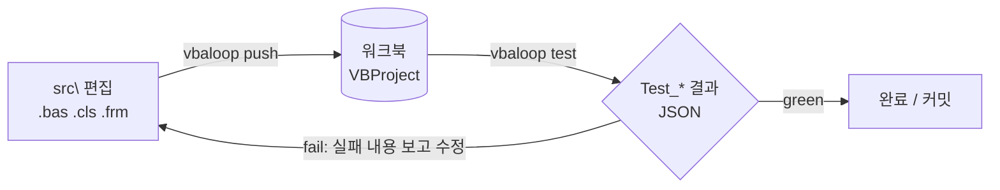

<h1 align="center">vbaloop</h1>

<p align="center">
  <b>코드 에이전트가 Excel VBA를 직접 고치고 테스트하게 해 주는 Windows CLI</b><br>
  Claude Code·Codex가 편집 → push → test → 수정을 사람 손 없이 반복한다
</p>

<p align="center">
  <a href="https://github.com/rfastball/vbaloop/releases/latest"></a>
  <a href="https://github.com/rfastball/vbaloop/actions/workflows/ci.yml"></a>
  
  <a href="LICENSE"></a>
</p>

<p align="center">
  <a href="#시작하기">시작하기</a> ·
  <a href="#작동-방식">작동 방식</a> ·
  <a href="#명령">명령</a> ·
  <a href="AGENT_SETUP.md">에이전트 설치 절차</a> ·
  <a href="DESIGN.md">설계</a>
</p>

> [!NOTE]
> **코드 에이전트에게 (For coding agents):** 사용자가 이 레포 주소와 함께 VBA·Excel 프로젝트의 설치나 세팅을
> 요청했다면 [AGENT_SETUP.md](AGENT_SETUP.md) 절차를 그대로 따른다. If a user gave you this repository to set up a
> VBA/Excel project, follow [AGENT_SETUP.md](AGENT_SETUP.md).

## 시작하기

### 준비물

- **Windows + 데스크톱 Excel.** 웹용·모바일 Excel은 자동화할 수 없다.
- **Claude Code 또는 Codex** (권장). vbaloop는 에이전트가 쓰도록 만든 도구지만, 명령은 사람이 직접 실행해도 된다.

새 프로젝트든 기존 워크북이든 시작 방법은 같다. 아래 둘 중 하나만 하면 된다.

### 방법 1. 터미널에서 직접 설치

**기존 워크북이 있는 폴더**, 또는 **새 프로젝트로 쓸 빈 폴더**에서 PowerShell을 열고 실행한다.

```powershell
irm https://raw.githubusercontent.com/rfastball/vbaloop/master/install.ps1 | iex
```

설치가 끝나면 바로 세팅으로 넘어간다. 폴더에 무엇이 있는지 보고, 바꾸기 전에 먼저 묻는다.

| 실행한 폴더 | vbaloop가 묻는 것 | 동의하면 |
|---|---|---|
| `정산.xlsm`이 있음 | "현재 폴더의 정산.xlsm을(를) 가져올까요?" | 옆에 `정산\` 폴더를 만들고 워크북을 복사해 **사본**으로 작업한다. 원본 워크북은 수정하지 않는다 |
| `.xlsm`이 여러 개 | 가져올 워크북 번호 | 고른 워크북을 위와 같이 사본으로 가져온다 |
| 비어 있음 | "여기에 새 프로젝트를 만들까요?" | 폴더 이름으로 워크북과 샘플 테스트를 만들고, 테스트가 실제로 통과하는지 확인한다 |

Excel 보안 설정 "VBA 프로젝트 개체 모델에 대한 신뢰할 수 있는 액세스"(AccessVBOM)가 꺼져 있으면 켤지 묻는다.
vbaloop가 워크북의 VBA 코드를 읽고 쓰려면 이 설정이 필요하다. 끝으로 Claude Code가 설치돼 있으면 새 프로젝트 폴더에서
Claude Code를 새 창으로 열지 묻는다.

### 방법 2. 에이전트에게 맡기기

기존 워크북이 있는 폴더나 빈 폴더에서 Claude Code나 Codex를 열고 이렇게 말한다.

```text
https://github.com/rfastball/vbaloop 로 이 폴더에 vbaloop를 세팅해줘
```

에이전트가 [AGENT_SETUP.md](AGENT_SETUP.md)대로 진행한다.

1. vbaloop 설치
2. 현재 폴더를 보고 기존 워크북인지 새 프로젝트인지 판단
3. `setup --plan`으로 무엇이 바뀌는지 보여주고 동의를 받는다. Excel 보안 설정이나 PATH처럼 PC를 바꾸는 항목은 반드시 묻는다
4. 세팅하고 결과를 보고한다

### 세팅이 끝나면

기존 워크북 `정산.xlsm`에서 시작했다면 폴더가 이렇게 된다.

```text
정산.xlsm                  원본 워크북 (수정하지 않음)
정산\                      ← 프로젝트 폴더. 에이전트는 이 폴더에서 연다
├─ 정산.xlsm               작업용 사본. push가 코드를 넣는 워크북
├─ src\                    워크북에서 꺼낸 모듈 (.bas .cls .frm) + 테스트용 LogShim.bas
├─ vbaloop.toml            프로젝트 설정
├─ CLAUDE.md, AGENTS.md    에이전트가 따를 규칙 (vbaloop가 관리하는 블록만 갱신)
├─ .claude\skills\vbaloop\ 실패했을 때 대응 절차 (Claude Code 스킬)
└─ .gitignore              _dbg\(로그·백업), dist\(배포본) 제외
```

이제 프로젝트 폴더에서 에이전트에게 평소처럼 일을 시키면 된다.

```text
modCalc의 합계 함수에 테스트를 붙이고 돌려줘
빈 시트에서 Run_Report 매크로가 오류 나는 거 고쳐줘
배포용 xlsm 만들어줘
```

에이전트는 `src\`를 고치고, `vbaloop push`로 사본 워크북에 반영한 뒤 `vbaloop test`로 확인한다. 실패하면 결과를 보고 다시 고친다.

<details>
<summary><b>다른 시작 방법</b> (exe 드래그 앤 드롭, 더블클릭, 명령 옵션)</summary>

<br>

이미 설치돼 있으면 워크북이 있는 폴더나 빈 폴더에서 `vbaloop setup`만 실행하면 된다. 방법 1과 똑같이 현재 폴더부터 제안한다.

- **기존 워크북**: `.xlsm`을 `vbaloop.exe` 위로 끌어다 놓는다.
- **새 프로젝트**: `vbaloop.exe`를 더블클릭하고 "기존 워크북(.xlsm)을 가져올까요?"에 `n`을 입력한 뒤 프로젝트 이름을 입력한다.
  프로젝트는 `%USERPROFILE%\vbaloop-projects\<이름>\`에 만들어진다.
- exe는 [릴리스](https://github.com/rfastball/vbaloop/releases/latest)에서 받는다. 서명되지 않은 exe라 SmartScreen 경고가
  뜨면 `추가 정보` → `실행`을 누른다.

명령으로 시작점을 직접 지정할 수도 있다.

```powershell
vbaloop setup --workbook C:\work\정산.xlsm    # 기존 워크북 → C:\work\정산\ 에 사본
vbaloop setup --new MyTool                     # 새 프로젝트 → .\MyTool\
vbaloop setup --folder C:\work\MyVba           # 준비해 둔 폴더(워크북 0~1개)를 그대로 사용
vbaloop setup --plan --workbook C:\work\정산.xlsm   # 아무것도 바꾸지 않고 계획만 보기
```

- 사본 폴더 이름이 이미 쓰이고 있으면 `<이름> (2)`처럼 비어 있는 이름을 쓴다. 같은 워크북으로 다시 실행하면 이전에 만든 폴더를 재사용한다.
- 사본을 둘 폴더를 직접 정하려면 `--workbook <경로> --folder <폴더>`를 함께 쓴다.
- `--yes`는 묻지 않고 진행한다(Claude Code 실행 제안도 건너뛴다). 단 AccessVBOM은 `--yes`로 켜지지 않는다.
  꺼져 있다면 `--enable-vbom`을 따로 붙여야 한다.
- 설치 한 줄로 설치만 하고 세팅은 건너뛰려면, 실행 전에 `$env:VBALOOP_NO_SETUP=1`을 설정한다. 입력을 받을 수 없는
  셸(에이전트, CI)에서는 이 설정 없이도 세팅을 묻지 않고 에이전트용 안내만 출력한다.

</details>

## 작동 방식



에이전트는 xlsm 안의 VBA 코드를 직접 읽거나 고칠 수 없다. 그래서 vbaloop는 코드를 `src\`의 텍스트 파일로 꺼내 두고,
이 파일을 코드의 기준으로 삼는다. 에이전트가 파일을 고치면 vbaloop가 워크북의 VBA 프로젝트에 넣고, 테스트 프로시저를
사람 조작 없이(헤드리스) 실행해 결과를 JSON으로 돌려준다. 에이전트는 그 결과를 보고 다음에 할 일을 정한다.

## 특징

| | |
|---|---|
| **한글이 깨지지 않는 왕복** | src와 워크북 사이에서 코드를 파일이 아닌 메모리(`CodeModule.Lines`)로 주고받아 코드페이지 변환이 없다. 한글처럼 시스템 코드페이지(ACP)에 있는 문자는 그대로 보존된다. 없는 문자(em dash, 이모지 등)는 VBE가 `?`로 바꿔 버리므로, push가 저장 전에 거부한다 |
| **안전한 push** | 코드를 넣기 직전에 워크북을 백업한다. 도중에 실패하면 이번 push가 바꾼 모듈을 전부 되돌린다. 나중에라도 `rollback`으로 백업에서 복원할 수 있다 |
| **헤드리스 테스트** | 테스트를 별도 프로세스에서 실행하고 시간 제한을 건다. VBE 오류 대화상자는 Office 언어와 상관없이 자동으로 닫는다 |
| **사용자 Excel 보호** | 응답하지 않는 Excel에 사용자 작업이 남아 있을 수 있으면 강제로 종료하지 않는다. 대신 격리 상태로 표시하고 확인을 요청한다(`recovery status`). 이미 열어 둔 워크북은 `session attach`로 그대로 쓴다 |
| **에이전트 연동** | `init`이 `CLAUDE.md`/`AGENTS.md`의 관리 블록과 Claude Code 스킬을 설치하고 최신으로 유지한다. 모든 명령이 `--json`을 지원한다 |
| **배포본 빌드** | `dist`가 테스트 모듈을 빼고 버전을 찍은 뒤, VBE 컴파일 검증까지 통과한 `.xlsm`/`.xlam`을 만든다 |
| **단일 exe** | 애드인이나 런타임 설치가 필요 없다. 설치 스크립트는 SHA-256을 확인한 뒤 `%LOCALAPPDATA%\vbaloop\bin` 한 곳에만 설치한다 |

## 테스트 작성

표준 모듈에 인자 없는 `Public Sub Test_*()`를 만들면 테스트가 된다. 단언은 `LogShim.AssertEq`를 쓴다.

```vb
Public Sub Test_SumTo()
    LogShim.AssertEq "1부터 3까지 합", 6, modCalc.SumTo(3)
    LogShim.AssertEq "0이면 0", 0, modCalc.SumTo(0)
End Sub
```

- 판정: 런타임 오류 없이 끝나고 실패한 단언이 0건이면 pass.
- `src\LogShim.bas`는 `init`이 넣고 관리한다. 직접 고치지 않는다.
- `Debug.Assert`는 헤드리스에서 아무 신호도 내지 않으므로 쓰지 않는다. 테스트 안에서 `MsgBox`·`InputBox`도 쓰지 않는다.

## 명령

| 명령 | 설명 |
|---|---|
| `setup [--workbook <xlsm> \| --new <이름> \| --folder <경로>] [--plan] [--enable-vbom]` | 프로젝트 세팅 마법사. 질문을 하는 유일한 명령이다. `--plan`은 바꾸지 않고 계획만 보여준다 |
| `init [--check] [--all]` | 관리 파일(규칙 블록, 스킬, `LogShim.bas`) 설치·갱신. `--check`는 검사만 하고, `--all`은 이 PC에서 쓴 프로젝트 전부를 갱신한다 |
| `doctor [--fix] [--kill-orphans]` | 환경 점검. `--fix`는 AccessVBOM을 켜고, `--kill-orphans`는 창 없이 남은 자동화 Excel을 정리한다(먼저 `doctor`로 대상 확인) |
| `status` | 세션 상태, src가 워크북에 반영됐는지 |
| `session start\|attach\|stop` | Excel 세션 시작, 이미 열린 워크북 채택, 종료(`--no-save`, `--discard`) |
| `push [--force] [--prune]` | src를 워크북에 반영 |
| `pull [--force]` | 워크북 코드를 src로 가져오기 |
| `diff [--module <이름>]` | 워크북과 src 비교(아무것도 바꾸지 않음) |
| `test [--timeout <초>]` | `Test_*` 테스트 실행 |
| `run <Module.Proc>` | 매크로 1개 실행 |
| `rollback --list\|--latest\|--backup <id>` | push 직전 백업으로 워크북 복원 |
| `recovery status\|clear [--force]` | 격리 상태 확인·해제 |
| `lint` | 인코딩·규약 검사(Excel 불필요) |
| `dist [--out <경로>]` | 배포본 빌드 |
| `lease acquire\|release\|status\|break` | 여러 에이전트가 한 프로젝트를 동시에 쓰지 않게 하는 잠금(보통 자동) |
| `bugreport "<제목>"` | vbaloop 결함 리포트 작성 |
| `version` | 버전과 빌드 정보 |
| `update [--check] [--yes]` | 최신 릴리스로 vbaloop 갱신(SHA-256 확인). 끝나면 `init --all` 실행 여부를 묻는다 |

- 모든 명령은 `--json`을 지원한다: `{command, ok, exitCode, hint, session, errors[], payload}`.
  새 버전 알림이 있으면 `update: {current, latest, command}`가 덧붙는다
- 실패하면 한 줄 에러와 다음에 할 일(`hint`)을 알려 준다.
- 종료 코드: 성공 0 / 환경 오류 3(세션·Excel 문제, 사용 중, 격리) / 그 외 2

## 설정 (`vbaloop.toml`)

`setup`(또는 `init`)이 자동으로 만든다. vbaloop는 현재 폴더에서 상위 폴더로 올라가며 처음 찾은 `vbaloop.toml`이 있는
폴더를 프로젝트 루트로 쓴다.

```toml
[project]
name = "MyProject"

[excel]
workbook = "MyProject.xlsm"
visible = true

[src]
root = "src"

[dist]                    # 선택
version = "1.0.0"
exclude = ["Test_*"]

[backup]                  # 선택
keep = 10                 # 0이면 push 전 백업 끔

[vbaloop]                 # init이 기록한다. 직접 고치지 않는다
managed_by = "0.3.0"      # 관리 파일을 마지막으로 쓴 vbaloop 버전
```

## 업데이트

vbaloop.exe는 PC에 한 번 설치되고, 관리 파일(`CLAUDE.md` 블록, 스킬, `LogShim.bas`)은 프로젝트마다 들어 있다.
둘의 버전이 어긋나지 않게 다음 규칙을 따른다.

- **새 버전 알림**: `status`, `doctor`, `version`, `init --check`가 새 릴리스를 알려 준다. 확인은 하루 한 번
  백그라운드에서 하므로 명령이 느려지지 않는다. 끄려면 `$env:VBALOOP_NO_UPDATE_CHECK=1`.
- **갱신**: `vbaloop update`. 새 exe를 받아 SHA-256을 확인하고 바꾼 뒤, 이 PC에서 쓴 프로젝트 전부에
  `init --all`을 돌릴지 묻는다(`--yes`면 묻지 않고 실행). `LogShim.bas`가 바뀐 프로젝트는 목록으로 알려 주며,
  각 프로젝트에서 `vbaloop push`를 한 번 하면 된다.
- **exe가 프로젝트보다 오래된 경우**: `vbaloop.toml`의 `managed_by`가 exe 버전보다 높으면 `init`은 아무것도
  바꾸지 않고 `vbaloop update`를 안내한다(종료 코드 3). 다른 PC에서 더 새 vbaloop로 작업한 레포를 받았을 때
  오래된 exe가 관리 파일을 되돌리지 않게 하기 위해서다. push/test는 경고만 하고 그대로 동작한다.

## 제약

- src 파일 규약: UTF-8(BOM 없음) + CRLF + 파일 끝 개행 1개.
- 프로시저 수준 Attribute(매크로 단축키 등)는 src와 워크북을 오가며 보존되지 않는다. 단축키는 `Application.OnKey`로 등록한다.
- 폼의 `.frx`(그림 등)만 바뀐 경우 push가 변경을 감지하지 못할 수 있다. 이때는 `push --force-form-import`로 반영한다.
- 테스트 중 뜬 `MsgBox`/`InputBox`/파일 대화상자는 자동으로 닫히지 않는다. 테스트는 시간 제한에 걸려 끝나고, Excel은
  격리될 수 있다. `recovery status`로 상태를 확인하고 안내를 따른다.

## 보안

vbaloop가 PC에 바꾸는 것은 셋이다: Excel의 "VBA 프로젝트 개체 모델에 대한 신뢰할 수 있는 액세스"(AccessVBOM),
`%LOCALAPPDATA%\vbaloop\bin` 설치와 사용자 PATH 등록, 프로젝트 폴더의 관리 파일. AccessVBOM은 마법사에서 동의하거나
`--enable-vbom`을 명시해야만 바뀌고, 무엇이 바뀌는지는 `setup --plan`으로 미리 볼 수 있다. 원본 워크북은 수정하지 않는다.
네트워크는 하루 한 번 GitHub에 최신 릴리스 번호를 묻는 것과 `vbaloop update`의 다운로드뿐이고, 코드나 워크북은 보내지 않는다.
자세한 내용과 되돌리는 방법, 취약점 제보는 [SECURITY.md](SECURITY.md),
포함된 제3자 코드는 [THIRD_PARTY_NOTICES.md](THIRD_PARTY_NOTICES.md)에 있다.

## 개발

```powershell
dotnet build
dotnet test                                    # Excel 불필요
dotnet publish src\VbaLoop -c Release -r win-x64
```

.NET 10 SDK가 필요하다. 릴리스는 `v*` 태그를 push하면 GitHub Actions가 만든다. 구현 근거는 [DESIGN.md](DESIGN.md).

## 라이선스

[MIT](LICENSE)
